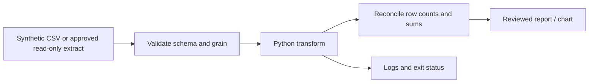

# Reporting Automation — Bash, BAT, Python and SQL Concepts

**Reference exercise only.** Nothing here connects to a real company system. Input data, paths, IDs and outputs must be fictional.



## Launchers across operating systems

Windows BAT example (assumes that a separately prepared `tools/synthetic_summary.py` exists):

```bat
@echo off
setlocal
py -3 tools\synthetic_summary.py --input data\demo.csv --output output\summary.csv
if errorlevel 1 exit /b 1
echo Completed synthetic validation
```

Linux Bash counterpart:

```bash
#!/usr/bin/env bash
set -euo pipefail
python3 tools/synthetic_summary.py --input data/demo.csv --output output/summary.csv
echo 'Completed synthetic validation'
```

**These are patterns, not executable files installed by this guide.** Do not execute a training script against real systems without approval and independent validation.

## Where a SQL client fits

A typical *generic* chain is `authorized read-only SQL client → CSV → Python QA → XLSX / PPTX / HTML → review`. The database client may be Oracle SQL*Plus, PostgreSQL psql, ClickHouse CLI or another approved utility, depending on the environment; none is configured here. Credentials never belong in source control or command-line logging. For a public demonstration, substitute a small invented CSV.

## Acceptance criteria

| Gate | Expected evidence |
|---|---|
| Inputs | Filename, period, required columns and row count recorded |
| Grain | Duplicate keys or ambiguous joins identified |
| Types | Invalid numeric/date values reported rather than coerced silently |
| Totals | Grouped counts and sums reconcile to the source |
| Repeatability | A second run produces the same result, not duplicate appended rows |
| Failures | Invalid input returns a non-zero exit code and useful diagnostic |
| Output | Chart or presentation is reviewed against the calculated table |
| Security | No secrets, real data or internal identifiers in files/logs |

Scheduling with cron or a systemd timer is **optional design** and does not make this example a deployed automation.

**RU:** связь BAT/Bash, Python, read-only SQL-выгрузки, проверки Data Quality и подготовки отчётности. Только синтетика; никаких рабочих подключений.

References: [GNU Bash](https://www.gnu.org/software/bash/manual/), [Python subprocess](https://docs.python.org/3/library/subprocess.html).
